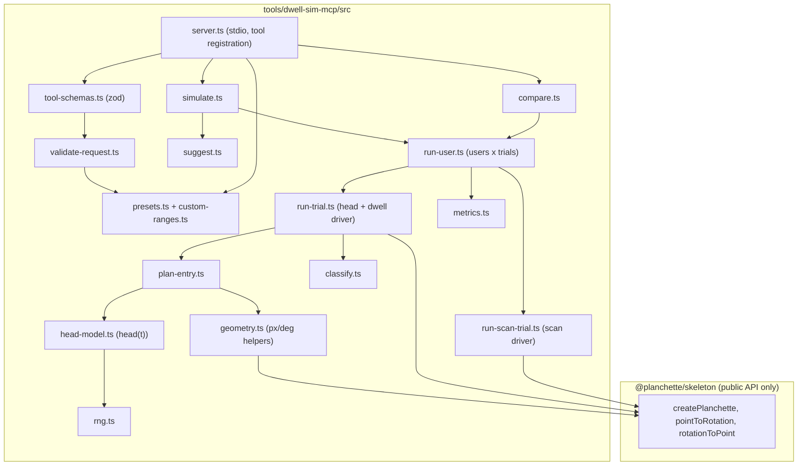
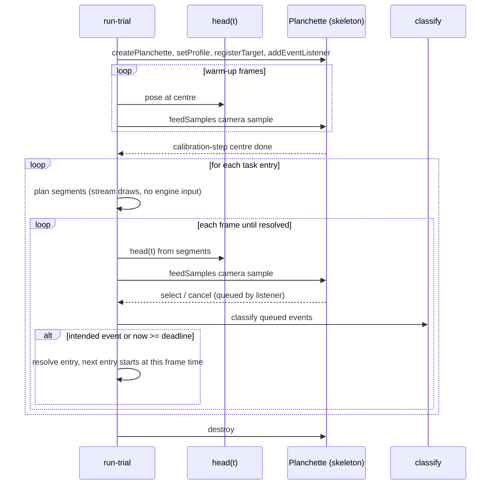

# Design: dwell simulator (MCP server)

## Overview

The dwell simulator is a stdio MCP server, `dwell-sim-mcp`, in `tools/dwell-sim-mcp/`. It
turns a simulated user's head movement into camera samples, feeds them to the real
skeleton through `@planchette/skeleton`, and reports accidental selections, misses and
time-to-select per user and per target. It never reimplements an engine (Requirement 1).

Four ideas hold the design together:

1. **The head is a pure function of simulated time.** For each trial the simulator plans a
   list of path segments, then evaluates `head(t)` at every frame time. `head(t)` reads
   nothing from the engine. The only closed-loop step is that the next task entry starts
   when the previous one resolves (Requirement 11).
2. **Counter-based random draws.** Every random value is `u(seed, userKey, trial, purpose,
   k, j)`, a hash of its own key. There is no generator state to advance, so a miss, a
   different user list or a different frame rate never shifts another draw (properties 1, 5, 7).
3. **One mapping.** The skeleton exposes `pointToRotation` and `rotationToPoint` (Requirement 9).
   The simulator uses them for every px/degree conversion, so it cannot disagree with the engine.
4. **Presets are data.** `list_users`, validation and `METHODOLOGY.md` checks are generated
   from the same typed tables, so a citation cannot drift from its number.

Results compare layouts and settings. Simulated users are models from published group
averages and do not predict any one person.

### Research summary (MCP SDK)

Checked with `npm view` and the SDK repository on the day of writing.

| Item | Finding | Source |
|---|---|---|
| `@modelcontextprotocol/sdk` | latest 1.32.2, MIT, Node `>=18`, peer dependency `zod ^3.25 \|\| ^4.0` | [npm](https://www.npmjs.com/package/@modelcontextprotocol/sdk) |
| v2 line | Published as new packages (`@modelcontextprotocol/server` 2.4.0, Apache-2.0, Node `>=20`). Not the package approved in `tech.md`. | [npm](https://www.npmjs.com/package/@modelcontextprotocol/server), [repo](https://github.com/modelcontextprotocol/typescript-sdk) |
| Tool API in v1 | `McpServer.registerTool(name, { title, description, inputSchema, outputSchema }, handler)`; the older `tool()` is `@deprecated`. `inputSchema` is a zod raw shape or a zod schema. With `outputSchema` the handler returns `structuredContent`. | [v1 server docs](https://github.com/modelcontextprotocol/typescript-sdk/blob/v1.x/docs/server.md), `dist/esm/server/mcp.d.ts` of 1.32.2 |
| Transport | `StdioServerTransport` from `@modelcontextprotocol/sdk/server/stdio.js`; `McpServer` from `@modelcontextprotocol/sdk/server/mcp.js`. | package files |
| zod | 4.6.7 latest, MIT | [npm](https://www.npmjs.com/package/zod) |

**Decision: v1 line, `@modelcontextprotocol/sdk` 1.32.2 (exact pin), `zod` 4.6.7 (exact pin).**
Reasons: Requirement 8.3 and `tech.md` approve `@modelcontextprotocol/sdk` (MIT) by name; v2 is a
different package with a different licence (Apache-2.0), so using it needs a new approval
(Requirement 8.7). zod is a required peer dependency of the SDK, and MIT, so Requirement 8.3
allows it. The server imports only the `server/mcp.js` and `server/stdio.js` subpaths, so
the HTTP, Express, Hono and OAuth code of the SDK is not loaded and no listening socket can
be opened (Requirement 8.1).

## Architecture

### Module overview



### Trial sequence



### Package layout

```
tools/dwell-sim-mcp/
  package.json  tsconfig.json  tsconfig.build.json  vitest.config.ts
  README.md  METHODOLOGY.md
  src/   server.ts  tool-schemas.ts  validate-request.ts  presets.ts  custom-ranges.ts
         figures.ts  rng.ts  geometry.ts  head-model.ts  plan-entry.ts  run-trial.ts
         run-scan-trial.ts  run-user.ts  classify.ts  metrics.ts  suggest.ts
         simulate.ts  compare.ts  task.ts  plan-start.ts  types.ts  disclaimer.ts
  scripts/ export-demo-layout.ts  run-demo-presets.ts      (compiled by tsconfig.scripts.json to dist-scripts/)
  test/   <thing>.test.ts and <thing>.props.test.ts, arbitraries.ts, golden/list-users.json
```

Conventions follow `structure.md`: kebab-case files, one main export per file, no `any`,
the skeleton imported only as `@planchette/skeleton`.

## Components and Interfaces

### 1. Skeleton additions (Requirement 9, the first work)

#### 1.1 One mapping function

The private `deadZone`, `toUnit` and `mapToPixel` in `head-pointer.ts` move unchanged to a new
internal file `skeleton/src/engine/pointer-mapping.ts`. `head-pointer.ts` imports
`mapCentredAngles` from it. No second copy remains (Req 9 AC 2). The file is internal: it
is not exported from `index.ts`.

```ts
// skeleton/src/engine/pointer-mapping.ts
import type { Profile } from './profile.js';

export type MappingProfile = Pick<Profile,
  'headGain' | 'headDeadZone' |
  'calibrationRangeLeft' | 'calibrationRangeRight' | 'calibrationRangeUp' | 'calibrationRangeDown'>;
export interface MappingScreen { width: number; height: number }

/** Centred angles (degrees, already minus the centre) -> integer pixel. The old mapToPixel. */
export function mapCentredAngles(dx: number, dy: number, p: MappingProfile, s: MappingScreen): { x: number; y: number };

/** Pixel (clamped to the screen) -> centred angles. Inverse of mapCentredAngles on the reachable area. */
export function unmapPixel(x: number, y: number, p: MappingProfile, s: MappingScreen): { dx: number; dy: number };
```

The public helpers are in `skeleton/src/pointer-helpers.ts`, re-exported by `index.ts` (they are
the only new runtime exports besides `createPlanchette`; both are pure, so `sideEffects: false` holds):

```ts
import type { FaceRotation } from './engine/head-pointer.js';   // { yaw, pitch } in degrees
import type { MappingProfile } from './engine/pointer-mapping.js';
import type { ScreenSize } from './api-types.js';

export type HeadRotation = FaceRotation;
export type ScreenPoint = { x: number; y: number };

/** A full Profile is assignable to MappingProfile. Arguments in the order of Req 9 AC 1. */
export function pointToRotation(profile: MappingProfile, screen: ScreenSize, centre: HeadRotation, point: ScreenPoint): HeadRotation;
export function rotationToPoint(profile: MappingProfile, screen: ScreenSize, centre: HeadRotation, rotation: HeadRotation): ScreenPoint;
```

`rotationToPoint` = `mapCentredAngles(rotation.yaw − centre.yaw, rotation.pitch − centre.pitch, …)`.
`pointToRotation` = `centre + unmapPixel(point)`. `MappingProfile`, `HeadRotation` and `ScreenPoint`
are exported as types. Neither helper mutates its arguments or reads any state.

The argument conventions match the existing API types: `ScreenSize` is `{ width, height }` in CSS px;
rotation is `{ yaw, pitch }` in degrees, with yaw > 0 to the right and pitch > 0 up (`head-pointer.ts`
header); `Profile` supplies the six mapping fields.

#### 1.2 The inverse

Let `W' = screenSize(width)`, `H' = screenSize(height)` (the existing `floor`, minimum 1 rule), `D = headDeadZone`,
`G = headGain`. The point is first clamped to `[0, W'−1] × [0, H'−1]`. A non-finite coordinate is treated as the
screen centre coordinate.

```
ux   = W' > 1 ? x / (W'−1) : 0.5
uyUp = H' > 1 ? 1 − y / (H'−1) : 0.5            // forward: uy = 1 − uyUp
unmapAxis(u, rPos, rNeg):
  if u === 0.5: return 0                         // the whole dead-zone band maps to 0.5; 0 is its centre
  rEff = (u > 0.5 ? rPos : rNeg) − D
  if !(rEff > 0): return u > 0.5 ? +D : −D       // forward gives 1 or 0 in this case
  dz = (u − 0.5) × 2 × rEff / G                  // inverse of u = dz/(rEff/G) × 0.5 + 0.5
  return sign(u − 0.5) × (|dz| + D)              // inverse of dz = sign(d) × max(0, |d| − D)
dx = unmapAxis(ux, calibrationRangeRight, calibrationRangeLeft)
dy = unmapAxis(uyUp, calibrationRangeUp, calibrationRangeDown)
```

- **Dead zone.** For `u ≠ 0.5` the result is the smallest rotation that produces `u`, just past the dead
  zone edge. The dead-zone band itself maps to the centre pixel, so every rotation inside it gives the same point.
- **Per-direction ranges.** The sign of `u − 0.5` picks `rPos` (Right for yaw, Up for pitch) or `rNeg`.
- **Head gain.** `G` divides `rEff` exactly as in the forward formula.
- **Clamping.** The forward clamp of `u` to [0, 1] is the reason the inverse clamps the point first.
  The result satisfies `|d| ≤ D + rEff/G ≤ R` on its side, because `G ≥ 1`.

**Reachable points.** The reachable area is the closed screen rectangle `[0, W'−1] × [0, H'−1]`. For every
profile accepted by `clampProfile`, `D ≤ 0.5 × minRange`, so `rEff ≥ 0.5 × minRange > 0` and the whole
rectangle can be reached with a rotation inside the calibrated ranges (design §1 of input-core, Property 11).
For a head range smaller than the calibrated range (Requirement 11), the reachable pixels are
`xMin..xMax` and `yMin..yMax`, computed by `rotationToPoint` at the extreme rotations
(`yaw = −left`, `+right`, `pitch = −down`, `+up`). The mapping is separable per axis and monotone, so
the reachable set is exactly that axis-aligned pixel rectangle.

**Rounding and the 1 px tolerance.** The forward mapping returns `round(u × (W'−1))`. For a real point
`p`, `unmapPixel` yields `u = p/(W'−1)` exactly up to float error (~1e-16 relative), so
`rotationToPoint(pointToRotation(p)) = round(p)`, within 0.5 px on each axis, and exactly `p` for an integer
`p`. The requirement's 1 px tolerance therefore has a 0.5 px margin for float error.

#### 1.3 Cancel payload (Req 9 AC 5, 6)

```ts
// api-types.ts
'cancel': { targetId?: string; now: number };   // was Record<string, never>
```

- `dwell.ts`: `{ type: 'cancel'; targetId: string; now: number }` (the cancel-role target that fired).
- `scan.ts`: `{ type: 'cancel'; now: number; targetId?: string }`. The virtual cancel item omits `targetId`;
  a cancel-role item selected as an ordinary item carries its id (`selectEvent` already knows `t.id`).
- `press-machine.ts` is unchanged. In `planchette.ts`, `cancelToIdle(now: number, targetId?: string)` emits
  `{ now }` or `{ now, targetId }`. The key is absent, never `undefined`. Callers: `emitDwell` (id, `e.now`),
  `emitScan` (`e.now`, `e.targetId`), `selectAt` for a cancel-role hit (id, `now`), hold-to-cancel from a
  switch or the gesture engine (`now`, no id), and `cancel: true` (Escape) samples (`now`, no id).
- Backward compatibility: `emit` still dispatches exactly one `CustomEvent('cancel')` per cancel, so a listener
  that ignores the payload runs once and cannot throw. Existing tests that compare the `detail` of a cancel
  with `{}` are updated to `{ now }`. A new test covers AC 6.

#### 1.4 Skeleton tests added (Req 9 AC 3, 4)

`skeleton/test/pointer-helpers.props.test.ts`:
(a) for any valid profile, screen and point in the reachable rectangle, `rotationToPoint(pointToRotation(p))`
is within 1 px per axis of `p`;
(b) for any valid profile, screen, centre and rotation, `rotationToPoint` equals the `pointer-move` that
`stepHeadPointer` emits on its first sample for that rotation (the filter is reset, so the first sample goes straight
to the pose). Both use arbitraries from `test/arbitraries.ts`.

### 2. Presets as data (`figures.ts`, `presets.ts`, `custom-ranges.ts`)

```ts
export type FigureRowId =
  | 'fitts-method' | 'head-tp-hmd' | 'head-we-hmd' | 'head-tp-phone' | 'head-tp-mobile'
  | 'min-jerk' | 'tremor-freq-pathological' | 'tremor-physiological' | 'tremor-parkinson'
  | 'tremor-intention' | 'head-tremor-et' | 'head-tremor-cd' | 'head-tremor-deg'
  | 'min-head-range' | 'ref-head-range';

export interface FigureRow { id: FigureRowId; label: string; value: string; refs: readonly number[]; }
export const FIGURES: Readonly<Record<FigureRowId, FigureRow>>;       // labels copied from the Figures table
export const REFERENCES: Readonly<Record<number, { citation: string; url?: string }>>;  // [1]..[8]

export type ParamSource =
  | { kind: 'figure'; row: FigureRowId; ref: number; note?: string }
  | { kind: 'chosen'; reason: string };

export interface Sourced<T> { value: T; source: ParamSource; }

/** Flat parameter values of one simulated user. */
export interface UserParams {
  throughputBitsPerS: number;
  tremorFrequencyHz: number;
  tremorPeakToPeakDeg: number;
  tremorAxis: 'yaw' | 'pitch';
  tremorDriftFraction: number;               // 0.2, not customisable
  headRangeDeg: { left: number; right: number; up: number; down: number };
  reactionTimeMs: number;
  readingPauseChancePct: number;
  readingPauseLengthMs: { min: number; max: number };
  trackingNoiseDeg: number;                  // peak, uniform in [-n, +n] per axis
  scatterCapDeg: number;
  scanReactionTimeMs: number;                // shared, not customisable
  scanLatePressChancePct: number;            // shared, not customisable
  scanPressDurationMs: number;               // shared, not customisable
}
export type SourcedParams = { [K in keyof UserParams]: Sourced<UserParams[K]> };
export interface PresetDefinition { name: PresetName; description: string; params: SourcedParams; }
export const PRESET_NAMES = ['steady','slow','head-tremor','strong-head-tremor','small-range','reads-while-pointing'] as const;
export type PresetName = typeof PRESET_NAMES[number];
export const PRESETS: Readonly<Record<PresetName, PresetDefinition>>;
```

Preset values (identical to the Presets section; every entry carries its `source`):

| Parameter | steady | slow | head-tremor | strong-head-tremor | small-range | reads-while-pointing |
|---|---|---|---|---|---|---|
| throughput | 1.42, figure `head-tp-mobile` [5] | 0.61, `head-tp-phone` [4] | 0.90, chosen "pairing", `head-tp-phone` [4] | 0.90 same | 0.90 same | 0.90 same |
| tremor f, p-p, axis | 0, 0, yaw (chosen: none) | same | 4.25 Hz `head-tremor-et` [8]; 0.46° `head-tremor-deg` [8]; yaw (chosen) | 4.25 Hz [8]; 1.6° chosen (ET mean + 2 SD); yaw | none | none |
| head range | ±15 chosen | ±15 | ±15 | ±15 | ±3, chosen "input-core minimum" (`min-head-range`) | ±15 |
| reading pause | 0 %, {0,0} chosen "none" | same | same | same | same | 30 %, {300, 900} chosen |
| tracking noise | 0 chosen | 0 | 0 | 0 | 0 | 0 |
| scatter cap | 0.6, figure `head-we-hmd` [3] (derived: 2.5° / 4.133) | same | same | same | same | same |
| reaction time | 500 chosen | same | … | … | … | … |
| drift fraction | 0.2 chosen | same | … | … | … | … |
| scan reaction / late chance / press duration | 500 ms / 10 % / 150 ms, chosen | same | … | … | … | … |

`CUSTOM_RANGES` is one typed table used by validation and by `list_users`:

```ts
export interface CustomRange { path: string; min: number; max: number; unit: string; }
export const CUSTOM_RANGES: Readonly<Record<CustomParamName, CustomRange>> = {
  throughputBitsPerS: { min: 0.3, max: 4 }, tremorFrequencyHz: { min: 0, max: 15 },
  tremorPeakToPeakDeg: { min: 0, max: 5 }, headRangeDeg: { min: 3, max: 60 /* each direction */ },
  reactionTimeMs: { min: 150, max: 1500 }, readingPauseChancePct: { min: 0, max: 100 },
  readingPauseLengthMs: { min: 0, max: 3000 /* min and max, min <= max */ },
  scatterCapDeg: { min: 0.1, max: 3 }, trackingNoiseDeg: { min: 0, max: 2 },
  analysisWindowS: { min: 2, max: 120 },
} as const;
```

`tremorAxis` is an enum (`yaw`, `pitch`). The scan parameters and the drift fraction are not
customisable (the requirement lists no range for them). A test checks that every `CUSTOM_RANGES` key is
overridable and every non-listed key is rejected as unknown.

`list_users` returns `PRESETS` mapped with `toListed(preset)` (value plus `citation` text, from `FIGURES` and
`REFERENCES`, or `"chosen: <reason>"`) and `CUSTOM_RANGES`. A resolved user is
`ResolvedUser = { name: string; key: number; params: UserParams }`, where `key` is the stable hash defined in §3.

### 3. Seeded randomness (`rng.ts`)

**Generator: a counter-based hash, not a stateful stream.** A draw is a pure function of its key, so it
cannot be shifted by anything that happened before it. This replaces "advance a stream" with "look up a draw",
which is what makes properties 1, 5 and 7 hold.

```ts
function mix32(z: number): number {                       // murmur3 fmix32
  z ^= z >>> 16; z = Math.imul(z, 0x85ebca6b); z ^= z >>> 13; z = Math.imul(z, 0xc2b2ae35); z ^= z >>> 16;
  return z >>> 0;
}
export function hash32(...ints: number[]): number {       // each int taken as int32
  let h = 0x811c9dc5;
  for (const x of ints) h = mix32((h ^ (x | 0)) + 0x9e3779b9 | 0);
  return h >>> 0;
}
export const enum Purpose { Aim = 1, Reaction, TremorPhase, TremorDriftKnot, ReadingPauseChance,
  ReadingPauseLength, TrackingNoise, ScanLatePress, TaskOrder, Start }
export interface Stream { readonly seed: number }          // = hash32(requestSeed, userKey, trialIndex, purpose)
export function stream(requestSeed: number, userKey: number, trialIndex: number, purpose: Purpose): Stream;
/** Uniform in [0, 1) with 53 bits, keyed by up to two counters. */
export function u01(s: Stream, k: number, j = 0): number {
  const hi = hash32(s.seed, k, j, 0) >>> 5, lo = hash32(s.seed, k, j, 1) >>> 6;
  return (hi * 67108864 + lo) / 9007199254740992;
}
```

`requestSeed` is the integer seed (default 1; non-integer seeds are rejected as `OUT_OF_RANGE`, range `-2^31 ..
2^31−1`). `userKey = hash32 of the user's UTF-16 name` for a preset, and `hash32` of the canonical JSON of its resolved
parameters plus name for a custom user. **Decision: keys are derived from the user, not the list position**, so adding,
removing or reordering users never changes another user's paths. Two identical users in one request produce identical
results (documented; not an error).

How draws are keyed:

| Purpose | `k` | `j` | Used for |
|---|---|---|---|
| Aim | task entry index | 0 or 1 (x, y) | the two uniforms of an aim point |
| Start | 0 | 0 or 1 (x, y) | the two uniforms of the aim point inside the rest area (start of session). Own label, so the start draw never shifts an entry's aim |
| Reaction | — | — | reserved (reaction time is fixed per user; kept so the label exists) |
| TremorPhase | 0 | 0 | φ, once per trial |
| TremorDriftKnot | knot index | 0 | `u_j` of the drift |
| ReadingPauseChance | entry index | layout target index | chance draw per crossed target |
| ReadingPauseLength | entry index | layout target index | length draw |
| TrackingNoise | `round(t × 1000)` (µs of simulated time) | 0 or 1 (yaw, pitch) | jitter |
| ScanLatePress | entry index | press index | late-press draw |
| TaskOrder | round index | position | shuffling `{ eachTarget: n }` and repairing adjacent duplicates (§4.8) |

- Because the aim draw is keyed by the entry index, a miss, an early resolution or a different number of earlier
  events never shifts a later aim.
- Tracking noise is a function of simulated time. Its draw count per second is not tied to the frame rate:
  each frame time maps to its own key. 15 fps and 60 fps see different jitter values at different instants
  (noise is white), which is why property 7 turns noise off.
- `compare` (property 5) uses the same request seed, user keys and trial indices for both configurations, and
  every key above depends on the entry index, the layout target index (ids sorted, see §9) or the time, never on the
  profile. The same draws are consumed.

### 4. Head model (`head-model.ts`, `geometry.ts`, `plan-entry.ts`)

All head angles are degrees, relative to the user's true centre pose `(0, 0)` (yaw right, pitch up). The simulator
uses the nominal centre `(0, 0)` in `pointToRotation` and `rotationToPoint`. The engine measures its own centre
in the warm-up (the mean over the stillness window), which differs from `(0, 0)` by about a tenth of a
degree at most with tremor on (`≈ a / (2π f T)` = 0.04° for 0.46° at 4.25 Hz over 1.5 s). That difference is a real effect
of the engine and is left in.

#### 4.1 Pixels and degrees (`geometry.ts`)

With `eff` the effective profile (`pl.getProfile()` after `setProfile`) and `screen`:

```
toPx(pose)   = rotationToPoint(eff, screen, ZERO, pose)       // ZERO = { yaw: 0, pitch: 0 }
toPose(px)   = pointToRotation(eff, screen, ZERO, px)
poseAtPx(px) = clampToHeadRange(toPose(px))                   // head range clamp, per direction
angularWidth(rect, axis) = |toPose({ x: rect.x + rect.width, y: cy }).yaw − toPose({ x: rect.x, y: cy }).yaw|   // axis 'x'; 'y' likewise with pitch
```

`angularWidth` uses the two rectangle edges, not a local derivative. On a linear stretch the two are equal. It differs
only for a rectangle that spans the dead zone, where the head really has to turn the extra `2D` degrees; that is
the width the user must scatter over, so the design keeps it.

#### 4.2 Movement time (Fitts' law)

For a move from pose `p0` to pose `p1` toward target `T`:

```
P0 = toPx(p0); P1 = toPx(p1); A = hypot(P1.x − P0.x, P1.y − P0.y)           // px
if A < 0.5: MT = 0 (no move segment)                                         // A is zero: the user holds
d = (P1 − P0) / A                                                            // unit direction
W = T.rect.width × |d.x| + T.rect.height × |d.y|                             // extent of the rect projected on d
ID = log2(A / W + 1)                                                         // Shannon
MT = max(MT_MIN, 1000 × ID / TP)                                             // ms, TP in bits/s
MT_MIN = 150 ms (chosen)
```

`MT_MIN` is chosen: it keeps a move at least two frames long at 15 fps (133 ms), so the minimum-jerk path is always
sampled at more than one point; the fastest ballistic head turns reported for pointing are of that order, but the figures
table gives no number, so it is marked "chosen". `W` is the projection of the whole rectangle on the movement
direction (for an axis-aligned move it is the width or height). `A` is measured to the aim point, which
sits inside the target; this is the nominal-distance form of the Shannon formulation.

#### 4.3 Minimum-jerk path

Movement is a straight line in (yaw, pitch) space. For a segment `[t0, t0 + MT]` from `a` to `b`:

```
τ = clamp((t − t0) / MT, 0, 1)
s(τ) = 10τ³ − 15τ⁴ + 6τ⁵
pose(t) = a + (b − a) × s(τ)
```

#### 4.4 Aim point and end-point scatter

For the aimed target `T`, entry `k`, user with scatter cap `C` (degrees), with `Wx = angularWidth(T.rect,'x')`
and `Wy = angularWidth(T.rect,'y')`:

```
SDx = min(Wx / 4.133, C);  SDy = min(Wy / 4.133, C)
zx = ttn(u01(aim, k, 0));  zy = ttn(u01(aim, k, 1))        // exactly 2 uniforms per aim
c  = toPose(centre of T.rect)
aim = clampToHeadRange({ yaw: c.yaw + zx × SDx, pitch: c.pitch + zy × SDy })
```

`ttn(u)` is a truncated normal on (−3, 3) by inverse transform:
`z = probit(Φ(−3) + u × (Φ(3) − Φ(−3)))`, then clamped to `±(3 − 1e-9)`, with `Φ(−3) = 0.0013498980316301`,
`Φ(3) = 0.9986501019683699` and `probit` the Acklam rational approximation (relative error 1.15e-9). It consumes
one uniform per axis and cannot fail or retry, so the draw count is fixed (2 per aim).

**The aim stays inside the target when it is at least 6 SD wide.** The aim is chosen relative to the target centre,
and `|z| < 3`, so the aim differs from the centre by less than `3 SD` per axis. If `W ≥ 6 SD` on an axis, half the
width is at least `3 SD`, so the aim lies strictly inside the rectangle in angle space, where the mapping is monotone.
Property 2 needs `W ≥ 6 SD` with `SD = min(W/4.133, C)`. Since `W/4.133 < W/6` is false (4.133 < 6), the condition can
hold only when `SD = C`, that is `W ≥ 6C`; the generator in the testing strategy enforces `W ≥ 6C` in degrees on both
axes (then `W/4.133 ≥ 1.45 C`, so `SD = C`). Two further effects are handled there: the aim in px is rounded (the
generator adds a 2 px margin), and the head-range clamp can move the aim (property 2 requires every target reachable,
so the clamp does not act).

#### 4.5 Tremor

Tremor is added to the base pose on one axis. For `t` in ms of simulated time since the first sample of the trial:

```
offset(t) = (a(t) / 2) × sin(2π f t / 1000 + φ)             // degrees, on yaw (default) or pitch
a(t)      = a0 × (1 + driftFraction × d(t))                  // a0 = tremorPeakToPeakDeg, driftFraction = 0.2
φ         = 2π × u01(tremorPhase, 0)                         // once per trial
d(t)      = lerp(U(j), U(j+1), smoothstep(x)),  j = floor(t / 5000),  x = t/5000 − j
U(i)      = 2 × u01(drift, i) − 1                            // in [−1, 1], memoised per trial
smoothstep(x) = x² (3 − 2x)
```

`d(t) ∈ [−1, 1]`, so `a(t)` stays within ±20 % of `a0`, and it changes over a period of about 5 s (Req 11 AC 5). Tremor is a
pure function of `t`, the user and the stream: it holds no per-frame state, so 15 fps and 60 fps sample the same continuous
signal. Tremor is on during the warm-up (the centre step then measures a stillness window that contains tremor; if
the peak-to-peak spread exceeds `calibrationStillnessThreshold` the step ends by timeout and the centre is the mean of
all samples, as the engine specifies).

#### 4.6 Tracking noise and clamping

```
noise(t) = n × (2 u01(noise, round(t × 1000), 0) − 1,  2 u01(noise, round(t × 1000), 1) − 1)    // n = trackingNoiseDeg
head(t)  = clampToHeadRange( base(t) + tremor(t) + noise(t) )
```

Noise is uniform in `[−n, +n]` per axis (chosen: "size" in Req 11 AC 8 is read as the peak, which also keeps
property tests bounded). `clampToHeadRange` clamps yaw to `[−left, +right]` and pitch to `[−down, +up]`
(Req 2 AC 4).

#### 4.7 Entry planning (`plan-entry.ts`)

A plan is a list of segments, so `head(t)` is piecewise and pure.

```ts
export type Phase = 'start-of-session' | 'waiting' | 'moving' | 'reading-pause' | 'holding';
export type StartSub = 'reaction' | 'moving';            // sub-phases of 'start-of-session'
export type Segment =
  | { kind: 'hold'; t0: number; t1: number; pose: Pose; phase: Phase; sub?: StartSub }
  | { kind: 'move'; t0: number; t1: number; from: Pose; to: Pose; phase: 'moving' | 'start-of-session'; sub?: StartSub };
export interface PausePlan { targetId: string; t0: number; t1: number; }
export interface EntryPlan {
  entry: number; targetId: string; role: TargetRole;
  tEntry: number; tMove0: number; deadline: number;      // deadline = tMove0 + analysisWindow
  segments: Segment[];  pauses: PausePlan[];  aim: Pose;  aimPx: Point;
}
export function planEntry(ctx: PlanContext, entry: number, tEntry: number, p0: Pose): EntryPlan;
```

`planEntry` uses only the user, the layout, the profile's mapping fields, the entry index, `tEntry` and `p0`:

```
1. reaction: hold(p0) over [tEntry, tEntry + RT), phase 'waiting'. tMove0 = tEntry + RT.
2. aim = §4.4 for the aimed target.
3. P0 = toPx(p0), Pa = toPx(aim). If A < 0.5 px: hold(aim) to deadline, phase 'holding'. Done.
4. Reading pauses. Sample the straight angle-space path q(λ) = p0 + λ (aim − p0) at N = min(2000, ceil(A) + 1) points.
   For each selectable target X (role ≠ 'rest-area', id ≠ aimed id, rect does not contain P0):
     λ_in = first sampled λ with toPx(q(λ)) inside X.rect; none: skip. λ_out = last such λ before leaving the rect.
     if u01(readingChance, entry, indexOf(X)) < chancePct/100:
        L = min + u01(readingLength, entry, indexOf(X)) × (max − min)
        pausePoint λ_p = λ_in + 0.5 × (λ_out − λ_in)                // READING_DEPTH = 0.5 (chosen)
   Sort the pauses by λ_p.
5. Pieces: points λ = 0, λ_p1, …, λ_pm, 1. Each piece is a minimum-jerk move whose duration is the §4.2 MT
   computed for that piece (A = piece length, W as for the whole move). A pause is hold(q(λ_p)) for L, phase 'reading-pause'.
   A piece with A < 0.5 px is skipped.
6. Final: hold(aim) from the end of the last move to deadline, phase 'holding'.
```

The pause is a stop at one point and the next piece starts at rest (a new minimum-jerk segment), as the requirement says.
Chance and length use keys that contain the entry index and layout target index, never the profile or the time, so the same
user draws the same chance in both configurations of `compare`.

`head(t)` finds the segment with a forward-only cursor (`t` increases), so evaluation is O(1) per frame.

#### 4.7a Start-of-session plan (`plan-start.ts`)

The start of session is planned like an entry, but it has no intended target and no reading pauses.

```ts
export interface StartPlan {
  tBegin: number;            // the frame time of the calibration-step 'centre'/'done' event
  tEnd: number;              // end of the start of session; the first task entry starts here
  segments: Segment[];       // phase 'start-of-session', sub 'reaction' then 'moving'
  endPose: Pose;             // p0 of entry 0
  restId: string | null;
  clamped: boolean;          // the rest point lies outside the user's head range
}
export function planStart(ctx: PlanContext, tBegin: number): StartPlan;
```

```
rest = first rest-area target in layout order (role 'rest-area')
if no rest:  tEnd = tBegin; segments = []; endPose = ZERO              // the user stays at the screen centre (Req 11 AC 10)
else:
  1. reaction: hold(ZERO) over [tBegin, tBegin + RT), phase 'start-of-session', sub 'reaction'   // the same RT as an entry
  2. aim: §4.4 with T = rest, draws u01(start, 0, 0) and u01(start, 0, 1), own label Purpose.Start
  3. move: ZERO -> aim, minimum-jerk, MT = §4.2 with A = distance from the screen centre pixel to aimPx and
     W = the rest rectangle projected on the movement direction; throughput = the user's TP;
     phase 'start-of-session', sub 'moving'. If A < 0.5 px there is no move.
  4. tEnd = end of the move; endPose = aim.
```

- **Same model as any aim.** Aim scatter, Fitts' law and the minimum-jerk path are the functions of §4.2 to §4.4, so no start-only movement code exists.
- **No reading pauses.** Step 4 of `planEntry` is not run for the start path: the start of session crosses any target between the centre and
  the rest area without stopping. Tremor (§4.5) and tracking noise (§4.6) are applied exactly as in an entry, because they are added
  in `head(t)`, not in the plan.
- **Activity and cause.** Every event with `now < tEnd` is classified `waiting` with cause `start` (§6), in both sub-phases and during
  the warm-up. A select or cancel while the user waits at the centre (the reaction sub-phase, or the whole warm-up) gets the same classification.
- **Not counted in time-to-select.** Entry 0 starts at `tEnd`; `tMove0` of every entry is measured from its own reaction wait, so the
  time in the start of session, and the warm-up, appear in no time-to-select (Req 1 AC 5, Req 11 AC 9).
- **Out of range.** If the rest point lies outside the user's head range, the clamp applies, `clamped` is true and the trial gets the warning `start-clamped`.

#### 4.8 Task expansion and validation (`task.ts`)

`expandTask(layout, spec, seed)` returns the explicit list of ids, or a validation error. Let `S` be the selectable targets (role ≠ `rest-area`)
sorted by UTF-16 order of id.

- **Explicit list.** For each index `i ≥ 1`, if `task[i] === task[i−1]` and the target does not have `autoRepeat`, return
  `ADJACENT_REPEAT` naming `i` (zero-based index of the second entry) and the id (Req 4 AC 26). The same id twice in a row on an `autoRepeat` target is allowed.
- **`{ eachTarget: n }`, `|S| > 1`.** Build the list round by round, then repair (deterministic, from the seeded `TaskOrder` stream):
  1. Shuffle: for round `r` in `0..n−1`, Fisher–Yates over a copy of `S` with `j = floor(u01(taskOrder, r, i) × (i + 1))` for `i` from `|S|−1` down to 1
     (swap positions `i` and `j`). Each round is a permutation of `S`, so it has no adjacent duplicate inside it.
  2. Repair: a duplicate can only appear at a round boundary. For `r ≥ 1`, if the first id of round `r` equals the last id of round `r−1`, swap the first and second
     element of round `r`. The second element differs from the first (a permutation of at least two distinct ids), so the new first id differs from
     the previous round's last id (which equalled the old first id), and the in-round order stays duplicate-free. Rounds are repaired in order; a repair
     changes only round `r`'s first two positions, so it cannot disturb the boundary with round `r−1` (already clean) and the boundary with round `r+1` is checked next.
  3. The single-target case (`|S| = 1`), the only one where step 2 has no distinct second element, is handled separately below.
  The result never has the same id twice in a row (Req 4 AC 27). Repair draws nothing, so the draw keys of step 1 are unchanged.
- **`{ eachTarget: n }`, `|S| = 1`, no `autoRepeat`, `n > 1`.** Return `ADJACENT_REPEAT` naming position `1` and the id (Req 4 AC 28). With `n = 1` the list is the one id.
- **`{ eachTarget: n }`, `|S| = 1`, `autoRepeat`.** The list is `n` copies of the id, not shuffled (Req 4 AC 29).

### 5. Trial driver (`run-trial.ts`)

```ts
export interface TrialConfig {
  layout: Layout; profile: Partial<Profile>; user: ResolvedUser; mode: 'head + dwell';
  task: readonly string[]; fps: 15 | 30 | 60; analysisWindowMs: number;
  requestSeed: number; trialIndex: number;
  observers?: { onEvent?(e: RawEvent): void };       // tests count events independently of the classifier
}
export function runTrial(cfg: TrialConfig): TrialResult;
```

```
function runTrial(cfg):
  eff = clampProfile-by-skeleton of { ...cfg.profile, mode: 'head + dwell',
          calibrationRangeLeft:  cfg.profile.calibrationRangeLeft  ?? user.headRange.left,   // Req 11 AC 1, per field
          ...Right, ...Up, ...Down }
  pl = createPlanchette({ screen, profile: eff, inputs: false, trackingIndicator: false })   // new instance per trial
  pl.setProfile(eff);  eff = pl.getProfile()                                                  // clamped, echoed in results
  for t of layout.targets: pl.registerTarget(t.id, t.rect, { autoRepeat: t.autoRepeat, role: t.role })
  queue = []; lastPointer = null
  pl.addEventListener('select', e => queue.push({ kind:'select', targetId:e.detail.targetId, now:e.detail.now }))
  pl.addEventListener('cancel', e => queue.push({ kind:'cancel', targetId:e.detail.targetId, now:e.detail.now }))
  pl.addEventListener('pointer-move', e => lastPointer = e.detail)       // updates two numbers, no allocation
  let centreDone = false
  pl.addEventListener('calibration-step', e => { if (e.detail.run==='centre' && e.detail.step==='done') centreDone = true })
  // all listeners are attached before the first sample

  frameMs = 1000 / fps;  k = 0;  face = { bbox:{cx:.5,cy:.5,w:.3,h:.4}, rotation:{yaw:0,pitch:0} }
  sample = { now:0, source:'camera', faces:[face] };  batch = [sample]            // reused, mutated in place
  feed(pose, now): face.rotation.yaw = pose.yaw; face.rotation.pitch = pose.pitch; sample.now = now; pl.feedSamples(batch)

  // 1. warm-up (Req 1 AC 3, 5): still at the centre pose, tremor and noise on
  cap = eff.calibrationStepTimeout + 1000
  while (!centreDone && k*frameMs <= cap): now = k*frameMs; feed(headWarm(now), now); drainWarm(); k++
  tDone = (k−1) × frameMs            // if the cap was hit: tDone = cap, warning 'centre-step-cap'
  // (events drained during the warm-up are classified like the start of session below: activity waiting, cause start)
  // 2. start of session (Req 11 AC 9, 10): the head is at the screen centre; with a rest area it moves there as a normal movement
  startPlan = planStart(ctx, tDone)                         // §4.7a; no segments and tEnd = tDone without a rest area
  while (k*frameMs < startPlan.tEnd): now = k*frameMs; feed(head(startPlan, now), now); k++
      for ev of drain(queue): record(classify(ev, startPlan, lastPointer, state))     // always accidental, cause 'start'
  // 3. entries
  p0 = startPlan.endPose; tEntry = startPlan.tEnd
  for entry in 0..task.length−1:
    plan = planEntry(ctx, entry, tEntry, p0)
    resolved = null
    while (resolved === null):
      now = k*frameMs; feed(head(plan, now), now); k++
      for ev of drain(queue): c = classify(ev, plan, lastPointer, state)
          record(c); if (c.intended && resolved === null) resolved = { kind:'selected', now: ev.now }
      if (resolved === null && now >= plan.deadline) resolved = { kind:'miss', now }
    results.entries.push(...);  tEntry = resolved.now;  p0 = basePose(plan, resolved.now)    // pure, from the segments
  pl.destroy()
```

Choices:

- **Start of session.** After the `calibration-step` `centre`/`done` event the head is at the screen centre. WHERE the layout has a rest-area target,
  the user waits the reaction time, then moves along a minimum-jerk path at the user's throughput to an aim point inside the rest area (§4.7a).
  No reading pause is applied on the way; tremor and noise are on. Events during the warm-up, the reaction wait and the movement
  are not hidden: they are accidental selections with activity `waiting` and cause `start` (Req 4 AC 11), so property 4 holds. Their count is
  reported per user as `startOfSession` and excluded from the rate per 100 (§7). WHERE there is no rest area, the user stays at the screen
  centre, the start of session has zero length, and the first entry starts at the `calibration-step` event. The time spent here is in no time-to-select.
- **Time origin.** Frame `k` has `now = k × (1000 / fps)`, starting at `k = 0`. The trial ends when the last entry resolves
  (no frames after it).
- **Feeding.** One `feedSamples` call per frame with a reused one-element array and a mutated sample object, so
  nothing is allocated per frame in the driver. The engine does not keep the sample (`feedOne` reads fields and
  `sanitizeFaces` copies). There is no `await` anywhere in a trial: all of it is synchronous.
- **When entry k+1 starts.** At the frame time `now` of the sample whose events resolved entry `k` (`tEntry = resolved.now`).
  The new plan only affects frames after `now`, so the sample at `now` was generated from the old plan. This is the
  only dependence of the head path on engine output.
- **Start pose of an entry.** `p0` is the base pose (no tremor, no noise) of the previous plan at its resolution time.
- **Deadline.** `tMove0 + analysisWindow`. An intended event on the same frame as the deadline wins.
- **Safety cap.** The warm-up loop is bounded by `calibrationStepTimeout + 1000 ms`; every entry loop is bounded by its deadline,
  so a trial always ends.
- **Unreachable targets.** The user still tries: the clamped head stays at the range edge and the entry misses at its
  deadline (Property 3).

### 6. Classification (`classify.ts`)

**Inputs.** The event `e = { kind: 'select' | 'cancel', targetId?, now }` in emission order; the plan in force `E`, which is
the `StartPlan` while `e.now < startPlan.tEnd` (this includes the warm-up) and otherwise the active entry plan
(entry, aimed target `A`, `segments`, `pauses`); the last `pointer-move` position `P`; the user and profile.

**Phase and activity label.** `phaseAt(E, t)` returns the `phase` of the segment with `t0 ≤ t < t1`; for `t ≥` the last
`t1` it returns the last segment's phase, and for any time before the start plan's `tEnd`, including the warm-up and a start plan with no
segments, it returns `start-of-session`. So the phases cover all times and every event gets exactly one label:

| Phase | Activity label |
|---|---|
| start-of-session (sub-phases `reaction` and `moving`, and the warm-up) | `waiting` |
| waiting | `waiting` |
| moving | `moving` |
| reading-pause | `reading pause` |
| holding | `holding on the aim point` |

The start-of-session phase is labelled `waiting` in both sub-phases because the glossary fixes that label for cause `start`. The reaction wait of each entry is `waiting`. The plan in force at `e.now` is the plan of the entry that was active when the
sample was fed; after an intended event resolves an entry, later events of the same sample are classified against the
new plan (its first phase, `waiting`, includes `tEntry`).

**Intended or accidental.** Let `Q(t) = toPx(base(t))` be the planned noiseless position.

```
aimedMatch = A.role === 'cancel' ? (e.kind === 'cancel' && e.targetId === A.id)
                                 : (e.kind === 'select'  && e.targetId === A.id)
intended   = phase !== 'start-of-session'
             && aimedMatch && ( phase === 'holding' || (phase === 'moving' && Q(e.now) inside A.rect) )
```

A `cancel` on the aimed cancel-role target matches by `targetId`, which Req 9 AC 5 now provides. A virtual-cancel or Escape
cancel has no `targetId` and is never intended. During `moving`, an event on the aimed target counts as intended once
the planned position is inside it (the user is arriving); an event on the aimed target while the planned position is still
outside it (tremor or noise put the pointer in early) is accidental with cause `early-on-intended-target` or
`tremor-at-edge`. During `waiting` and `reading-pause` nothing is intended.

**Cause, first match wins, for accidental events only.** `ampPx` is the tremor peak amplitude in px
(`a0 × (1 + driftFraction) / 2` degrees on the tremor axis, converted with `toPx(base ± amp)` at `Q`) plus the noise
peak `n` in px, plus 1 px of rounding. `edgeDist(Z, R)` is the distance from point `Z` to the boundary of rectangle
`R` (0 on the boundary; for a point inside, the least distance to the four edges; outside, the distance to the rectangle).

| # | Cause | Condition |
|---|---|---|
| 1 | `start` | phase is `start-of-session` (the event is before the start plan's `tEnd`: warm-up, reaction at the centre, or the start movement) |
| 2 | `repeat` | `target(e)` is `autoRepeat`, the previous select/cancel event of the trial was on the same target, and no `pointer-move` between the two left its rect |
| 3 | `waiting` | phase is `waiting` |
| 4 | `reading-pause` | a pause `R` in `E.pauses` has `R.targetId = e.targetId` and `R.t0 ≤ e.now < R.t1 + graceTime + 500 ms` (the 500 ms is `LAG_ALLOWANCE_MS`, chosen: above the measured smoother lag of 400 ms at smoothing strength 0.9) |
| 5 | `tremor-at-edge` | tremor or noise is on and (`edgeDist(Q(e.now), rect(target)) ≤ ampPx` or `edgeDist(P, rect(target)) ≤ ampPx`); false when `e.targetId` is absent |
| 6 | `early-on-intended-target` | `e.targetId = A.id` and phase is `moving` |
| 7 | `pass-over` | phase is `moving` (target not aimed) |
| 8 | `other` | always |

**Order.** `start` is first: every event in the start-of-session phase is `start`, whatever else would match (Req 4 AC 11), and the activity label is `waiting`.
`repeat` goes before `waiting`. With `waiting` first, an auto-repeat select
that lands in the reaction wait after a selection on the same auto-repeat target would be labelled `waiting` and the
cause that the developer can act on (the auto-repeat setting) would be lost. Activity labels are not affected. All other
positions are as suggested. The `repeat` rule cannot match during the start of session because rule 1 already took the event.

**Totality.** Intended or accidental is a boolean of defined values. The label is a total function of `phaseAt`. The cause list ends in an
unconditional `other`. Hence each event gets exactly one classification, one label and (if accidental) one cause
(property 4). The classifier is a pure function of its inputs; it is called once per drained event.

**Miss causes** (used by suggestions): `unreachable` (target outside the user's reachable pixel rectangle), else
`tremor-at-edge` (tremor or noise on and `edgeDist(aimPx, rect) ≤ ampPx`), else `other`.

### 7. Metrics and results (`metrics.ts`)

```ts
export interface TrialEntryResult {
  entry: number; targetId: string; outcome: 'selected' | 'miss';
  timeToSelectMs: number | null;                 // eventNow − tMove0
  missCause: 'unreachable' | 'tremor-at-edge' | 'other' | null;
}
export interface AccidentalRecord {
  targetId: string | null;                       // null for a cancel without a target
  timeMs: number; activity: Activity; cause: AccidentalCause; entry: number;
}
export interface TrialResult {
  userName: string; trialIndex: number;
  entries: TrialEntryResult[]; accidental: AccidentalRecord[];
  warnings: string[]; effectiveProfile: Profile;
}
export interface TargetMetrics {
  targetId: string | null; intended: number;
  accidental: number;                            // includes events with cause 'start' (Req 4 AC 2, 25)
  startCount: number;                            // accidental events with cause 'start'
  accidentalPer100Intended: number | null;       // excludes start events, see the formula below
  misses: number;
  timeToSelectMs: { median: number | null; p90: number | null };
  causes: Record<AccidentalCause, number>; activities: Record<Activity, number>;
}
export interface UserMetrics extends TargetMetrics {
  userName: string; trials: number; perTarget: TargetMetrics[];
  startOfSession: { count: number; byTarget: { targetId: string | null; count: number }[] };   // Req 4 AC 25; count = startCount
}
```

- `timeToSelectMs = event.now − tMove0`, from the moment the user starts moving to the intended selection. The warm-up and the start of session are before every `tMove0` and are in no time-to-select.
- Percentile: nearest rank, `sorted[ceil(p × n) − 1]`, `null` when `n = 0`.
- **Rate (Req 4 AC 2, 13, 25).** `accidentalPer100Intended = ((accidental − startCount) / intended) × 100`, and `null` when `intended = 0` (never 0 or NaN).
  `accidental` is the full count and includes the `start` events; `startCount` is the count of accidental events with cause `start`. The same
  formula is used per user and per target. A `start` event has the target it hit (or `null` for a cancel without a target), so per target it is in that
  target's `accidental` and `startCount`, and the per-target rate excludes it too.
- `startOfSession.byTarget` lists the targets hit by `start` events (sorted by id, `null` last), with their counts; its counts sum to `startOfSession.count`.
- Aggregation: counts are summed over the trials of a user; time-to-select samples are pooled; per-target figures
  group by the aimed target (intended, misses, time) or by the event's target (accidental; `null` bucket for an unattributed cancel).
- Notes and warnings (top level of the result): a note when any user has `tremorPeakToPeakDeg > 1` ("tremor … exceeds
  the size the smoothing is tuned for", AC 14); warnings `NO_REST_AREA` and `NO_CANCEL_TARGET` for `head + dwell`
  with the text and the accessibility rule they cite (AC 15, 16); `start-clamped`, `centre-step-cap` from trials.
- Echo: `seed`, the full request parameters after defaults, the resolved users (all parameters), and `effectiveProfile`
  (the skeleton's `getProfile()` after clamping) so a run is reproducible (AC 4).
- The result has no wall-clock or random-id field (property 1).
- The disclaimer is the constant in `disclaimer.ts`, exactly: "Simulated users are models from published group averages,
  not real people. Use these results to compare layouts and settings."

### 8. Suggestions and follow-up runs (`suggest.ts`)

Inputs: the aggregated per-target data over all users, the pooled task list, the layout. For each selectable target `T`:

```
centre-hit rule (below) first: it does not use events(T) and is not limited by the threshold      // Req 6 AC 10
events(T)  = accidental records on T with cause ≠ 'start' + misses whose aimed target is T       // start events are not about T's use
if |events(T)| < 3: no event-based suggestion for T                      // AC 7
reading(T) = count(accidental on T with cause 'reading-pause') / count(accidental on T)
edge(T)    = count(events on T with cause/missCause 'tremor-at-edge') / |events(T)|
if reading(T) > 0.5 -> suggestion "longer dwell time"
     and, if T is on the path of a commonly used target, "or move T away from the path"
if edge(T)    > 0.5 -> suggestion "larger target or more spacing", then the follow-up run below
if T is unreachable for user U (outside U's reachable pixel rectangle) -> "outside U's head range; higher head gain or move T"
```

- **Centre-hit rule (Req 6 AC 10).** Let `C = (floor(screen.width / 2), floor(screen.height / 2))` be the screen centre pixel (the pixel the engine
  maps a centred head to). For each selectable target `T` (role ≠ `rest-area`; rest areas are excluded from the hit-test) with `T.rect` containing `C`
  (`x ≤ C.x < x + width` and `y ≤ C.y < y + height`), add one suggestion naming `T`: keep the screen centre empty, or put the rest area there. The
  suggestion is made whether or not the layout has a rest-area target, and without regard to the 3-event threshold of AC 7 and to any events.
  Its metric is `screen-centre-hit` and its `users` list is empty (it comes from the layout, not from a simulated user).
- Events with cause `start` are left out of the reading-pause, tremor-at-edge and threshold counts, because they say where the start path went, not how `T` is used.

- **Commonly used target:** at least 20 % of all task entries pooled over every trial of the run.
- **On the path:** for some pair of consecutive intended entries `(i → j)` where `j` is a commonly used target and `T` is
  neither, the straight segment between the two target centres passes within one target width (`T.rect.width`) of `T.rect`
  (segment-to-rectangle distance: zero if they intersect, else the least distance between the segment and the four edges).
- **Unreachable (Req 6.3):** reachability per user is the pixel rectangle `[xMin, xMax] × [yMin, yMax]` from
  `rotationToPoint` at the extreme head-range rotations with the effective profile (§1.2). `T` is outside when no pixel of its
  rectangle `[x, x + w) × [y, y + h)` is inside. Each suggestion lists the metric (`reading-pause share`, `tremor-at-edge share`,
  `unreachable`) and the user names that produced the events (AC 4).
- **Follow-up run (AC 5, 8, 9).** For a tremor-at-edge suggestion on `T`, for `s` in `[1.25, 1.5, 2]` in order: scale `T.rect`
  about its centre by `s`, intersect with the screen rectangle, run again only the users that had events on `T`, with the same
  request seed and the same task; stop at the first run with zero accidental selections and zero misses on `T`.
  The suggestion states that multiple `s`. If none reaches zero, the suggestion has no follow-up size (AC 9).
  Overlap with another target is allowed, because stopping would hide the answer and shrinking would not test the size that was
  asked for; the follow-up record lists the ids it overlaps (the engine's first-in-list rule decides overlaps) and the
  suggestion text says "this size overlaps X". At most 3 extra runs per suggested target.
- Nothing is suggested when no result supports it (AC 6).

The suggestion record in the output has `{ targetId, metric, users, text, followUp? }`; the centre-hit suggestion has `metric: "screen-centre-hit"`, `users: []` and no `followUp`.

### 9. `compare` (`compare.ts`)

```ts
interface CompareRequest {
  a: { layout: Layout; profile?: Partial<Profile>; label?: string };
  b: { layout?: Layout; profile?: Partial<Profile>; label?: string };   // b.layout defaults to a.layout
  mode, users, task, trialsPerUser, fps, analysisWindowS, seed;
}
```

Both configurations must have the same set of target ids (`LAYOUT_MISMATCH` otherwise). Everything outside `a`/`b` is
shared. The `eachTarget` task is built from the ids sorted by UTF-16 order and the `TaskOrder` stream, so it is the same
in both. The 'layout target index' in draw keys is the index in that sorted order, not the registration order.

For each `(user, trial)` both configurations run with the same user key, request seed and trial index. Paired metrics:
accidental count and miss count per trial (fewer wins); time-to-select per trial is the median over entries selected in both
configurations (entry `k` paired with entry `k`), counted only when at least one entry was selected in both (lower wins). Equal values are
ties. The output has, per metric, `{ aWins, bWins, ties, verdict }` where `verdict` is `"a did better"`, `"b did better"`
(more wins) or `"tie"` (equal wins; AC 3, 4), plus the per-trial pairs and the sentence "These counts are not a test of
statistical significance." (AC 6).

**Same head samples (AC 7).** The selection-timing fields are exactly `dwellTime`, `graceTime`, `postSelectionPause`,
`autoRepeatInterval` and `smoothingStrength`. `head(t)` depends on: the user, the stream draws (entry/time keys),
the layout, the mapping fields (gain, dead zone, ranges), `fps`, `tEntry` and `p0`. None of these is a timing field. The
warm-up end `tDone` depends on `calibration*` fields and the head samples, not on the five fields (calibration reads the
unsmoothed rotation). So the plan of entry 0 is identical in both runs, and every later plan is identical until
the first entry whose resolving event time differs; its `tEntry` is the only input that can differ. That is the "first
differing select or cancel" of property 5. For other differences (gain, ranges, layout, AC 8) the draws are the same but head
samples may differ.

### 10. Scan mode (`run-scan-trial.ts`) — lower priority

Implemented after the head + dwell path, and only against the requirements the head path leaves open (AC 4.7, 4.8, 4.24, 1.6).

- **Setup.** Profile `mode: 'scan'`. No warm-up and no centre step (Req 1 AC 6). The trial starts at `t = 0`; entry 0 starts at `tEntry = 0`. Every frame
  sends `{ now, source: 'synthetic', signal: down }` (a tick) with `down` from the user's press plan.
- **Watching.** The user listens to `highlight` events and tracks the current one. The *right highlight* for aimed target `A` is
  `kind 'item'` with `targetId = A.id`, or `kind 'row'` with `A.id ∈ targetIds` and more than one id. A `'none'` highlight
  (scan paused) is answered by one press after the reaction time, which resumes and selects nothing.
- **Press.** When the right highlight appears (or is already current at `tEntry`) at time `t_h`, the registered press time is
  `t_act = t_h + scanReactionTime`, plus one `scanInterval` with probability `scanLatePressChancePct`
  (`u01(scanLatePress, entry, pressIndex)`): the press lands one item late and acts on the next item. The switch is held for
  `scanPressDurationMs` (150 ms, below `cancelHoldTime`, whose minimum is 1000 ms): `signal = true` on
  `[t_act − 150, t_act)`. With cancel-by-hold on the press registers on release, so the engine acts at `t_act` on the item
  highlighted just before. The `$back` and `$cancel` items are never pressed.
- **Resolution.** An event is intended if it is `select` (or, for a cancel-role aim, `cancel`) on `A.id`, after the right highlight appeared.
  Otherwise accidental. The deadline is `tEntry + analysisWindow`; a miss moves on. After a resolution or miss, the next entry
  starts at that time and the user reads the current highlight.
- **Time-to-select.** From `tEntry` (the user starts watching; there is no reaction wait and no movement) to the event `now`.
- **Phases.** `waiting` until the right highlight is seen, then `holding` (press pending). `moving` and `reading-pause`
  do not occur. Causes reduce to `waiting` (phase waiting) and `other`; `repeat` cannot occur (no auto-repeat in scan).
- The scan trial returns the same `TrialResult` shape, so metrics, suggestions (only the reading-pause and tremor rules are
  skipped: they need head movement) and `compare` reuse everything.

### 11. MCP server (`server.ts`, `tool-schemas.ts`, `validate-request.ts`)

**Files and run.**

- `src/server.ts` is the entry. It begins with `#!/usr/bin/env node`. It replaces `console.log` with `console.error`
  (stdout is the protocol), creates `new McpServer({ name: 'dwell-sim-mcp', version })`, registers the three tools with
  `registerTool`, and connects `new StdioServerTransport()`. It opens no socket and makes no network call.
- At start it checks that `@planchette/skeleton` resolves. If not, it writes to stderr "Build the skeleton first: npm run
  build --workspace=skeleton" and exits with code 1.
- `package.json`: `"bin": { "dwell-sim-mcp": "dist/server.js" }`, `"main": "dist/server.js"`, `"files": ["dist","README.md","METHODOLOGY.md"]`.
- Root scripts: `"build:sim": "npm run build --workspace=skeleton && npm run build --workspace=tools/dwell-sim-mcp"`,
  `"sim": "node tools/dwell-sim-mcp/dist/server.js"`. The README tells clients to launch with `node` (or `npm run sim --silent`), because npm
  prints a banner on stdout without `--silent`, which would corrupt the protocol.

**Input validation strategy.** The zod schemas describe structure and types only (so the SDK passes the request on),
and put ranges and caps in `.describe()` text. `validate-request.ts` then checks every range and cap and returns the stable
error codes below. This keeps the machine-readable `code` ours; the SDK's own validation message would not carry it.

```ts
import { z } from 'zod';
const Rect = z.object({ x: z.number(), y: z.number(), width: z.number(), height: z.number() });
const Target = z.object({ id: z.string(), rect: Rect,
  autoRepeat: z.boolean().optional(), role: z.enum(['default','cancel','undo','rest-area']).optional() });
const Layout = z.object({ screen: z.object({ width: z.number(), height: z.number() }), targets: z.array(Target) });
const CustomUser = z.object({
  name: z.string(), base: z.string().optional(),                         // preset to start from, default 'steady'
  overrides: z.object({
    throughputBitsPerS: z.number().optional(),
    tremorFrequencyHz: z.number().optional(), tremorPeakToPeakDeg: z.number().optional(),
    tremorAxis: z.enum(['yaw','pitch']).optional(),
    headRangeDeg: z.object({ left: z.number().optional(), right: z.number().optional(),
                             up: z.number().optional(), down: z.number().optional() }).optional(),
    reactionTimeMs: z.number().optional(), readingPauseChancePct: z.number().optional(),
    readingPauseLengthMs: z.object({ min: z.number(), max: z.number() }).optional(),
    scatterCapDeg: z.number().optional(), trackingNoiseDeg: z.number().optional(),
  }).strict() });
const Task = z.union([z.array(z.string()), z.object({ eachTarget: z.number() })]);
const Mode = z.enum(['head + dwell','scan','head + gesture','gesture scan','mouse']);
export const SimulateInput = {
  layout: Layout, profile: z.record(z.string(), z.unknown()).optional(), mode: Mode.default('head + dwell'),
  users: z.array(z.union([z.string(), CustomUser])), task: Task,
  trialsPerUser: z.number().default(10), fps: z.number().default(30),
  analysisWindowS: z.number().default(10), seed: z.number().default(1),
};
```

The `profile` object is passed to the skeleton, which clamps it (Req 4 AC 1). Unknown keys are ignored by the skeleton's
`clampProfile`. `compare` has `a`, `b`, and the shared fields. `list_users` has an empty input shape.

**Caps, ranges and the checks (in this order):** mode → users count (≤ 12) → each preset name / custom range → layout (targets
≤ 100, ids, rects, selectable targets exist) → task (entries ≤ 500, ids known (`UNKNOWN_TARGET`), no adjacent repeat on a non-`autoRepeat`
target (`ADJACENT_REPEAT`, §4.8); `eachTarget` an integer 1–100 and n × selectable ≤ 500) → trialsPerUser (integer 1–50) → fps ∈ {15, 30, 60} → analysisWindowS 2–120 → seed integer.

**Result shape.** On success: `structuredContent` (validated by `outputSchema`) and one text content item holding the same JSON.
On a validation error: `{ isError: true, content: [{ type: 'text', text: JSON.stringify(err) }], structuredContent: err }` where
`err = { code, parameter, message, allowed?: string[] | { min, max } }`. The SDK skips output validation for `isError` results;
a test checks that.

| Code | Trigger | Message template |
|---|---|---|
| `UNKNOWN_PRESET` | a user string is not a preset | `Unknown preset "{name}". Valid presets: {list}.` |
| `OUT_OF_RANGE` | a custom parameter, `analysisWindowS`, `seed`, `trialsPerUser`, `eachTarget` outside its range | `Parameter {path} must be between {min} and {max} {unit}; got {value}.` |
| `CAP_EXCEEDED` | users > 12, trialsPerUser > 50, targets > 100, task entries > 500 | `Parameter {path} allows at most {cap}; got {value}.` |
| `NOT_ALLOWED_VALUE` | `fps` not 15/30/60 | `Parameter fps must be one of 15, 30, 60; got {value}.` |
| `UNSUPPORTED_MODE` | mode is `head + gesture`, `gesture scan` or `mouse` | `Input mode "{mode}" is not supported. Supported modes: head + dwell, scan.` |
| `NO_SELECTABLE_TARGETS` | no targets, or only `rest-area` targets | `The layout has no selectable targets (no targets, or only rest-area targets).` |
| `UNKNOWN_TARGET` | a task id is not in the layout | `Task entry {index} names target "{id}", which is not in the layout.` |
| `ADJACENT_REPEAT` | an explicit task lists the same non-`autoRepeat` target twice in a row; or `{ eachTarget: n }`, n > 1, with one selectable target that is not `autoRepeat` (position 1) | `Task entry {index} repeats target "{id}" directly after entry {index-1}, and the target has no autoRepeat. Entries are numbered from zero.` |
| `INVALID_LAYOUT` | duplicate or empty id, non-finite or non-positive rect or screen | `Layout problem at {path}: {reason}.` |
| `LAYOUT_MISMATCH` | `compare` layouts have different id sets | `The two layouts must have the same target ids; differing: {ids}.` |
| `UNKNOWN_PARAMETER` | an override key is not customisable | `Parameter {path} cannot be overridden. Customisable: {list}.` |
| `INTERNAL_ERROR` | an exception in a run | `The simulation failed: {message}.` (also written to stderr) |

**Output examples** (shortened).

`list_users`:
```json
{ "users": [ { "name": "steady", "description": "…", "parameters": {
      "throughputBitsPerS": { "value": 1.42, "source": "Head pointing throughput, mobile head tracker [5]" },
      "tremorPeakToPeakDeg": { "value": 0, "source": "chosen: no tremor" } } } ],
  "customRanges": { "throughputBitsPerS": { "min": 0.3, "max": 4, "unit": "bits/s" } },
  "disclaimer": "Simulated users are models from published group averages, not real people. Use these results to compare layouts and settings." }
```

`simulate`:
```json
{ "seed": 1, "parameters": { "mode": "head + dwell", "fps": 30, "analysisWindowS": 10, "trialsPerUser": 10,
    "task": { "eachTarget": 2 }, "profile": { "dwellTime": 1000 }, "effectiveProfile": { "…": "all 30 fields" },
    "users": [ { "name": "steady", "params": { "…": "all values" } } ] },
  "users": [ { "name": "head-tremor", "trials": 10, "intended": 38, "accidental": 5, "accidentalPer100Intended": 10.5,
      "startOfSession": { "count": 1, "byTarget": [ { "targetId": "menu", "count": 1 } ] },
      "misses": 2, "timeToSelectMs": { "median": 2310, "p90": 3590 },
      "causes": { "start": 1, "tremor-at-edge": 3, "pass-over": 1 }, "activities": { "waiting": 1, "moving": 1, "holding on the aim point": 3 },
      "perTarget": [ { "targetId": "ghost", "intended": 4, "accidental": 3, "startCount": 0, "accidentalPer100Intended": 75,
                       "misses": 1, "timeToSelectMs": { "median": 2100, "p90": 2900 } } ] } ],
  "accidentalSelections": [ { "user": "head-tremor", "trial": 3, "targetId": "ghost", "timeMs": 18420,
                              "activity": "holding on the aim point", "cause": "tremor-at-edge" },
                            { "user": "head-tremor", "trial": 0, "targetId": "menu", "timeMs": 1900,
                              "activity": "waiting", "cause": "start" } ],
  "suggestions": [ { "targetId": "ghost", "metric": "tremor-at-edge share 0.75", "users": ["head-tremor"],
                     "text": "…larger target (1.5 times the current size had no accidental selections and no misses)…" },
                   { "targetId": "menu", "metric": "screen-centre-hit", "users": [],
                     "text": "The screen centre lies inside target \"menu\". Keep the centre empty or put the rest area there." } ],
  "warnings": [ "No rest area: …" ], "notes": [ "…" ],
  "disclaimer": "Simulated users are models from published group averages, not real people. Use these results to compare layouts and settings." }
```
With no data the rate and percentiles are `null`. In the example the rate is (5 − 1) / 38 × 100 = 10.5: the `start` event is in `accidental`
and in `startOfSession.count`, and out of the rate. The `outputSchema` of `simulate` (zod) declares, per user, `startCount`-bearing metrics and
`startOfSession: { count: number, byTarget: { targetId: string | null, count: number }[] }`; `causes` and each record's `cause` use the
eight-value enum (`start` included); a suggestion is `{ targetId: string, metric: string, users: string[], text: string, followUp?: { factor: number, overlaps: string[] } }`.
`compare` pairs count accidental selections including `start` events, as in the user's `accidental` field.

`compare`:
```json
{ "seed": 1, "parameters": { "…": "both configurations" },
  "metrics": { "accidental": { "aWins": 14, "bWins": 22, "ties": 24, "verdict": "b did better" },
               "misses": { "aWins": 3, "bWins": 3, "ties": 54, "verdict": "tie" },
               "timeToSelect": { "aWins": 20, "bWins": 31, "ties": 5, "verdict": "b did better", "pairedTrials": 56 } },
  "pairs": [ { "user": "steady", "trial": 0, "a": { "accidental": 1, "misses": 0, "medianTimeMs": 2200 },
               "b": { "accidental": 0, "misses": 0, "medianTimeMs": 2050 } } ],
  "statement": "These counts are not a test of statistical significance.", "warnings": [], "notes": [],
  "disclaimer": "Simulated users are models from published group averages, not real people. Use these results to compare layouts and settings." }
```

### 12. Performance (Requirement 7 AC 3)

Estimate for 6 presets × 10 trials × 20 entries at 30 fps. A typical entry lasts reaction 0.5 s + movement 1 to 3 s + dwell
1 s + pause 0.5 s ≈ 3 to 5 s, or 90 to 150 frames; the `slow` user reaches 8.5 s per move, 250 frames. A trial is 20 entries +
about 4 s warm-up: ≈ 2 000 to 5 000 frames. 60 trials is 120 000 to 300 000 frames. The engine does one head step, one dwell
step and two `CustomEvent` dispatches (`dwell-progress`, `pointer-move`) per frame; at about 10 to 20 µs per frame the run takes
1.2 to 6 s.

Measures: no `await` per sample; a reused sample, face and one-element batch; `head(t)` with a forward cursor and no
allocation (poses are written into a preallocated object); the listeners do no allocation except for the rare
select and cancel records; the driver does not subscribe to `dwell-progress`; knots for tremor drift are memoised. If the
benchmark fails, users are independent and can be split across `worker_threads`; that is not designed in v1.

**Verification.** `test/performance.test.ts` runs 6 presets × 10 trials × 20 entries at 30 fps on a fixed 9-target layout with a
rest area and asserts `elapsed < 10 000 ms` (a generous bound, measured with `performance.now()` around the whole run, which
is allowed in a test and not in the simulator), and prints the measurement; the measurement is recorded in `docs/kiro-journal.md`.

### 13. METHODOLOGY.md and README outline

`METHODOLOGY.md`: (1) purpose and the disclaimer; (2) the movement model in the order of the Movement model section with the formulas of
§4; (3) the Figures table with every row, its value, its reference number and link (generated from `FIGURES` and `REFERENCES` by
a script, checked by the golden test); (4) derived values worked out: scatter cap `SD = 72 px / 4.133 = 17.4 px`,
`2.5° / 4.133 = 0.6°`; tremor size `peak-to-peak = (deg/s between extrema) / (2π f)` giving 12.3 / (2π × 4.25) = 0.46° and
7.77 / (2π × 4.37) = 0.28°; the "ET mean + 2 SD = 1.6°" value as chosen, not a percentile; (5) chosen values with reasons (reading pause
numbers, reaction time, noise 0, drift, `MT_MIN`, `READING_DEPTH`, `LAG_ALLOWANCE_MS`, noise as uniform peak, scan parameters);
(6) limits: tremor is a pure sinusoid and real tremor is less regular, the model is open loop, no dropouts, engine-level
rotation (the camera adapter's maths is not modelled), the scatter cap comes from head pointing in a head-mounted display,
all the Out of scope items; (7) how determinism works (seed derivation).

`README.md`: what it is; requirements (Node `>=20`, a built skeleton, with `npm run build:sim`); start command (`node
tools/dwell-sim-mcp/dist/server.js`, `npx dwell-sim-mcp`, `npm run sim --silent`); Kiro `mcp.json` entry:

```json
{ "mcpServers": { "dwell-sim": { "command": "node",
    "args": ["/ABSOLUTE/PATH/TO/planchette-kit/tools/dwell-sim-mcp/dist/server.js"], "disabled": false } } }
```
with the note that the path must be absolute because the client's working directory is not the repo; the `npx dwell-sim-mcp` form
needs the package linked or installed; tool reference with the three examples above; limits.

**Demo-layout run (Requirement 12).** `scripts/export-demo-layout.ts` (run from the repo root, using the root's `@playwright/test`, not
imported by the server) builds the site, serves it with `vite preview`, opens `/` at 1920 × 1080 and again at 1366 × 768, reads
`window.planchetteDemo.planchette.getTargets()` and the viewport, and writes `tools/dwell-sim-mcp/demo-layout-<w>x<h>.json` as
`{ screen, targets }`. **Scripts run from compiler output, not from TypeScript stripping.** A second config, `tsconfig.scripts.json`
(`include: ["scripts"]`, `rootDir: "scripts"`, `outDir: "dist-scripts"`, `module` and `moduleResolution` as in `tsconfig.build.json`), compiles the scripts. The scripts import the
built simulator from `../dist/*.js`, so `tsconfig.scripts.json` needs no `paths`. The workspace `build` script is
`tsc -p tsconfig.build.json && tsc -p tsconfig.scripts.json`; it emits `dist/*.js` (the server, `bin`, `main`) and `dist-scripts/*.js`. The scripts run with plain `node`, never with
Node's TypeScript stripping: `node tools/dwell-sim-mcp/dist-scripts/export-demo-layout.js` and `node tools/dwell-sim-mcp/dist-scripts/run-demo-presets.js`, exposed as the
workspace scripts `demo:export` and `demo:run` (both run `build` first; `build:sim` builds the skeleton before it). Relative imports in `src` and `scripts` carry the `.js` extension
(the repo's ESM convention), and the root `@playwright/test` is resolved from the repo root `node_modules`. The typecheck `tsconfig.json` includes `scripts/`, so `npm test` type-checks them. `dist-scripts/` is git-ignored like `dist/`.
`scripts/run-demo-presets.ts` calls `simulate` in-process with the six preset names (each exactly once) on that file,
default profile, `{ eachTarget: 3 }`, seed 1, and appends to `docs/kiro-journal.md` six entries, one per preset:

```
### <date> dwell-sim-mcp demo run: <preset> (1920x1080, seed 1)
- Intended: n  Accidental: n (per 100: x)  Misses: n  Time-to-select median/p90: a / b ms
- Top causes: …  Suggestions: …
```

### 14. Packaging

- Root `package.json`: `"workspaces": ["skeleton", "tools/dwell-sim-mcp"]`.
- Root scripts: `"typecheck": "tsc --noEmit -p skeleton/tsconfig.json && tsc --noEmit -p tools/dwell-sim-mcp/tsconfig.json"`,
  `"test": "npm run typecheck && npm run test --workspace=skeleton --workspace=tools/dwell-sim-mcp"`, `build:sim` and `sim` as above.
- `tools/dwell-sim-mcp/tsconfig.json` (typecheck, `noEmit`): `strict`, `paths: { "@planchette/skeleton": ["../../skeleton/src/index.ts"] }`
  (the same mapping the skeleton's own example uses), `include: ["src","test","scripts"]`. So typecheck and Vitest need no
  built skeleton. `tsconfig.build.json` has no `paths` (it resolves the skeleton's `dist/index.d.ts`), `include: ["src"]`, `rootDir: src`, `outDir: dist`.
  `tsconfig.scripts.json` compiles `scripts/` to `dist-scripts/` (§13), so every script runs from compiler output with `node`.
  Project references are not used: the skeleton's own configs are `noEmit` for typecheck.
- `vitest.config.ts` aliases `@planchette/skeleton` to the source. The one test that launches the built server over stdio
  (`server.stdio.test.ts`) needs `dist` and is skipped with a stderr note when `dist/server.js` is missing; the root `test` script runs
  `build:sim` first so it does run there.
- `engines`: `"node": ">=20"` (Requirement 10 AC 5; the `CustomEvent` global is available from Node 20 and the SDK needs `>=18`).
- Dependencies (exact pins): `@modelcontextprotocol/sdk` 1.32.2, `zod` 4.6.7, `@planchette/skeleton` `*` (workspace); dev: `fast-check`
  4.10.3, `vitest` 5.1.1, `typescript` 7.0.2 (the same pins as the skeleton).
- `THIRD_PARTY.md` entries: `@modelcontextprotocol/sdk` 1.32.2 MIT; `zod` 4.6.7 MIT; plus the packages the SDK pulls in
  (`ajv`, `ajv-formats`, `cors`, `express`, `hono`, `jose`, … resolved by `npm ls --all`), each with exact installed version and licence, and a
  check script that fails the test run if an installed production package is missing from `THIRD_PARTY.md`.
- Skeleton prerequisite: the skeleton's `exports` point to `dist`, so `npm run build --workspace=skeleton` must run first for the built server.

## Data Models

Core types are in `types.ts`:

```ts
export interface Point { x: number; y: number }
export interface Pose { yaw: number; pitch: number }
export interface LayoutTarget { id: string; rect: Rect; autoRepeat: boolean; role: TargetRole }
export interface Layout { screen: ScreenSize; targets: LayoutTarget[] }
export type Activity = 'waiting' | 'moving' | 'reading pause' | 'holding on the aim point';
export type AccidentalCause = 'reading-pause' | 'pass-over' | 'tremor-at-edge' | 'repeat' | 'waiting'
                            | 'early-on-intended-target' | 'other' | 'start';
export type TaskSpec = readonly string[] | { eachTarget: number };
export interface RawEvent { kind: 'select' | 'cancel'; targetId?: string; now: number }
export interface SimulateRequest { layout: Layout; profile: Partial<Profile>; mode: 'head + dwell' | 'scan';
  users: ResolvedUser[]; task: TaskSpec; trialsPerUser: number; fps: 15 | 30 | 60; analysisWindowS: number; seed: number }
```

`Rect`, `ScreenSize`, `TargetRole`, `Profile` are the skeleton's public types. `UserParams`, `Sourced`, `TrialResult`, `TargetMetrics`,
`UserMetrics`, `EntryPlan`, `StartPlan` are above. `task.ts` expands and validates tasks as in §4.8.


## Correctness Properties

*A property is a characteristic or behavior that should hold true across all valid executions of a system-essentially, a formal statement about what the system should do. Properties serve as the bridge between human-readable specifications and machine-verifiable correctness guarantees.*

The eight properties below keep the numbering and the conditions of the "Properties (property-based tests)" section of
requirements.md. Property reflection: the other testable criteria (Fitts' formula, minimum-jerk formula, tremor bound, clamping,
noise bound, custom-range validation, suggestion thresholds, win/tie verdicts) are single-function checks. They are
implemented as supporting unit-level property tests (listed in the Testing Strategy) and are not repeated as numbered
properties, because properties 1 to 8 already cover them end to end. Requirement 9's two properties are skeleton tests (§1.4).

### Property 1: Deterministic

*For any* valid request and seed, running the request twice returns results identical in every field, and the result contains no
wall-clock field.

**Validates: Requirements 4.4, 7.1, 7.2, 7.4**

### Property 2: Clean run, no accidents, no misses

*For any* layout and any simulated user such that tremor, tracking noise and reading pauses are off, no target has `autoRepeat`, the
scatter is truncated at ±3 SD with the per-user SD cap, every target is at least 6 SD wide on both axes, the screen centre is
outside every selectable target, the dwell time is longer than the longest planned crossing time of any non-intended target (the planned
crossing times include the start-of-session path), the analysis window is above reaction time + movement time + dwell time + post-selection pause, and every target is reachable, each
intended target is selected exactly once, with no accidental selection and no miss.

(The generator builds "at least 6 SD wide" as `W ≥ 6 × SDcap` in degrees on both axes plus a 2 px rounding margin, so `SD = SDcap`; see §4.4.)

**Validates: Requirements 4.2, 4.9, 4.10, 4.12, 11.3, 11.4**

### Property 3: Unreachable means miss

*For any* head-pointing trial with the profile's calibration ranges set above the user's head range, and any target whose rectangle
contains no pointer position reachable within the head range (computed with the skeleton's mapping helpers), the skeleton emits no
`select` or `cancel` event for that target, and every intended entry for it is a miss. A partly reachable target is not covered.

**Validates: Requirements 11.1, 11.2, 11.11, 11.12**

### Property 4: Every event is accounted for

*For any* completed run, the number of intended selections plus accidental selections equals the number of `select` and `cancel` events the
skeleton emitted during the trials, counted by a listener that is independent of the classifier, and each accidental selection has exactly
one activity label and exactly one cause from the Glossary sets. The accidental count includes the selections with cause `start` (from the
start of session and the wait at the start), which carry activity `waiting`; their count is also reported as `startOfSession.count` and is left out of the rate per 100 intended
selections only, by the formula (accidental − start) / intended × 100.

**Validates: Requirements 4.3, 4.9, 4.10, 4.11, 4.25**

### Property 5: Same random draws when comparing

*For any* two configurations in `compare` run with the same users, seed and trials, both consume the same random draws. If they differ only in
`dwellTime`, `graceTime`, `postSelectionPause`, `autoRepeatInterval` or `smoothingStrength`, the head-angle samples are identical up to the first
differing `select` or `cancel` event (`dwell-progress` events are not compared).

**Validates: Requirements 5.1, 5.7, 5.8**

### Property 6: Longer dwell, fewer reading-pause accidents

*For any* profile and stay on a target shorter than `dwellTime`, the stay never produces a `select` on it (part a). *For any* fixed (open-loop) sample
stream with no `autoRepeat` targets, where consecutive non-intended stays are at least d_new + `postSelectionPause` apart, raising `dwellTime` from
d_old to d_new never increases the accidental count, and every accident under d_new is also an accident under d_old (part b). The known counterexample
that the restriction in (b) excludes (d1 = 1000 ms, d2 = 1200 ms, `postSelectionPause` 500 ms, S1 from 0 to 1000 ms, S2 from 1100 to 2400 ms with a
900 ms reading pause inside it) is pinned as a fixed example test.

**Validates: Requirements 6.1**

### Property 7: Frame rate

*For any* trial with tremor, tracking noise, reading pauses and `autoRepeat` targets off, and meeting input-core P15's boundary conditions B1, B2, B4 and
B5 (B3 is replaced by the next sentence), 15 fps and 60 fps give the same sequence, order and count of intended selections, and each time-to-select
differs by at most 140 ms (input-core measured 133 ms of smoother-lag difference between 15 and 60 fps).

**Validates: Requirements 2.2, 2.3, 7.4**

### Property 8: Each task entry resolves once

*For any* completed trial, intended selections plus misses equal the task length.

**Validates: Requirements 4.12, 11.11**

## Error Handling

- **Validation errors** (all the codes in §11) are returned as a tool result with `isError: true`, a `code`, the `parameter` path and a message
  that names the parameter and its range or cap. No report is produced, no engine is created. Checks run in the fixed order given in §11, so
  the first problem is the one reported, deterministically.
- **Custom user ranges** are checked against `CUSTOM_RANGES` (the same table `list_users` returns). A `readingPauseLengthMs` with `min > max` is `OUT_OF_RANGE`
  with the path `readingPauseLengthMs.min`.
- **Engine and driver faults.** The driver never throws on a simulated input: the skeleton ignores malformed samples. An exception inside a run is
  caught at the tool boundary, logged to stderr with the request seed, and returned as `INTERNAL_ERROR`. Stdout carries only protocol messages.
- **Warm-up cap.** If the centre-step event never arrives within `calibrationStepTimeout + 1000 ms` of simulated time (it should not happen: the engine's own timeout is
  shorter), the trial continues with warning `centre-step-cap`.
- **Unreachable or clamped starts.** A rest point outside the head range adds the warning `start-clamped`; the trial still runs.
- **Missing skeleton build.** The server exits with code 1 and an instruction on stderr when `@planchette/skeleton` cannot be resolved.
- **No network, no stdout logging.** `console.log` is redirected to `console.error` at startup.
- **Result honesty.** When a rate, median or percentile has no data it is `null` (never 0 or NaN). Warnings and notes are always present as arrays.

## Testing Strategy

**Approach.** Property-based testing applies: the simulator is deterministic logic with clear input and output (planning, classification, metrics,
seeded draws) and universal invariants. Libraries: `fast-check` 4.10.3 with `vitest` 5.1.1 (already approved, tech.md). Each property is one
property-based test with at least 100 runs (`numRuns: 100`; 200 for 1, 4 and 8), tagged with a comment
`Feature: dwell-sim-mcp, Property N: <text>`. No property-based testing is written from scratch. No test turns on a real camera: every sample is synthetic.
Where a property touches only pure code (planning, classification, metrics) it runs without the skeleton; the others run the real skeleton through `createPlanchette`
(aliased to source in Vitest).

**Shared arbitraries (`test/arbitraries.ts`).**

- `layoutArb({ minTargets, maxTargets, minSide })`: screen 640–1920 × 480–1080; targets built on a jittered grid so rectangles are inside the screen and
  do not overlap by construction (cell size minus margin), one `rest-area` and optionally one `cancel` target. Overlap is built out, not filtered out.
- `presetArb` and `customUserArb`: values inside `CUSTOM_RANGES` drawn with `fc.double` bounded by the range (boundaries included).
- `profileArb`: from the skeleton's `validProfile()` pattern, limited to the fields the properties vary.
- `taskArb(layout)`: lists of selectable ids with no adjacent repeats (except on `autoRepeat` targets), or `{ eachTarget }`.
- Shrinking: layouts shrink toward fewer targets; users shrink toward `steady`; tasks toward length 1. Counts and seeds are plain integers.

**Per property.**

1. *Deterministic.* Generate a full request (layout, users, task, `fps`, window, seed, trials 1–3), run `simulate` twice, `expect(a).toEqual(b)`, and walk the JSON to
   assert no `Date`-like or `NaN` field. Also run once with the users in reverse order and assert each user's result is unchanged (stable user keys).
2. *Clean run.* The generator enforces every condition by construction: tremor 0, noise 0, chance 0, `autoRepeat` false; the user's `scatterCapDeg` is drawn first, then every target is sized
   `W ≥ 6 × SDcap` in degrees (converted with the mapping at the target) plus 2 px, so `SD = SDcap`; the screen centre is outside every selectable
   target (the grid leaves the centre cell for the rest area, or empty); `dwellTime ≥ max planned crossing time of any non-intended target + 1 ms`, where the test computes the
   crossings from the plans of the entries and from the `StartPlan` (the path from the screen centre to the rest area crosses targets without a reading pause, so it is included); the window is
   `RT + MT + dwell + pause + 1000 ms` capped at 120 s (and the MT bound uses the slowest throughput in the range); all targets reachable (head range ≥ profile
   ranges). Tasks use targets in the layout. Assertion: `intended = task length`, `accidental = 0`, `misses = 0`, and each target selected once per entry.
3. *Unreachable means miss.* Users with `headRangeDeg` 3–10° and profile ranges 1.5–3× larger. The test computes the reachable pixel rectangle with the helpers and places one target
   fully outside it (when none exists in the generated screen the case is built by moving the target, not discarded). Assertion on the event stream of a listener attached through `observers`:
   no select or cancel for that id; every entry for it is a miss.
4. *Every event accounted for.* `observers.onEvent` is attached to the same planchette by the test, independent of the driver's queue. Assertion: `intended + accidental = count`, the
   `accidentalSelections` list length equals `accidental`, and every record has an activity from the four labels and a cause from the eight (`start` included). The generator mixes layouts with and without a rest area and targets between the screen centre and the rest area, so
   `start` events occur; the test also asserts that every event with `now` before the start plan's end has activity `waiting` and cause `start`, that
   `startOfSession.count` equals the number of `start` records, and that `accidentalPer100Intended = (accidental − startCount) / intended × 100` (`null` for `intended = 0`). A classifier-level property feeds random
   events and plans (including unattributed cancels) and asserts totality.
5. *Same random draws.* Run both configurations with only timing fields differing (generator picks any subset of the five fields with different values). Both runs record
   the head samples (a recording hook in `observers.onSample`). Assertion: the sample sequences are equal element by element until the sample after the first event whose
   `(kind, targetId, now)` differs between the runs, and both runs' aim offsets `(zx, zy)` per entry are equal. A second arbitrary changes other fields (gain, dead zone, layout size)
   and asserts the draw keys and `(zx, zy)` are equal, without asserting the samples.
6. *Longer dwell.* Part (a) is generated from `stayArb`: a target, a stay duration below `dwellTime`, a profile; the stream is built with camera samples through the real engine, with a lost-face frame
   before each stay and each gap so the filter resets and the pointer jumps exactly onto the pose (the input-core B3 technique), no `autoRepeat`. Part (b) generates stays with
   start-to-start gaps `≥ d_new + postSelectionPause` for non-intended stays by construction (each gap is drawn as that bound plus a non-negative offset), runs the same stream under `d_old < d_new`,
   and asserts the accident count is non-increasing and the set of accident stays under d_new is a subset of the set under d_old (a select is mapped to the stay that contains its `now`).
   The fixed example test `props6.counterexample.test` replays d1 = 1000, d2 = 1200, `postSelectionPause` 500, S1 [0, 1000], S2 [1100, 2400] and records that the restriction excludes it.
7. *Frame rate.* The generator builds B1 by choosing stays shorter than `dwellTime − 67 ms` or longer than `dwellTime + postSelectionPause + 134 ms`: the layout puts targets on a line with the
   rest area apart, so non-intended crossings are shorter than `dwellTime − 67 ms`; B2 by making each target at least `6 SDcap_px + 40 px` wide so every aim (resting pointer) is more than 20 px from the edge; B4 by
   drawing `reactionTimeMs ≥ postSelectionPause` (reaction ≤ 1500 ms limits `postSelectionPause` to 200–1500 ms in this generator); B5 by `autoRepeat` false. The same request runs at 15 and 60 fps.
   Assertion: same ordered list of `(entry, targetId)` intended selections and `|ttsM15 − ttsM60| ≤ 140` per entry. Because tremor is a pure function of `t`, and noise is off, the two runs sample the same head path.
8. *Each entry resolves once.* Any request from the shared arbitraries, with a mix of reachable and unreachable targets and a short window (2–10 s) so misses are common. Assertion per trial:
   `intended + misses = task length`, and the entry indices of the results are exactly `0..n−1` with no duplicates.

**Supporting property tests (not numbered).** `fitts-mt` (formula, monotone in A and W, floor), `min-jerk` (formula, endpoints, monotone), `tremor` (|offset| ≤ 0.6 a0, a(t) in [0.8, 1.2] a0 for any t, equal at any
two sampling rates), `head-clamp` (any `t`), `noise-bound`, `ttn` (|z| < 3 and the 2-draw count), `rng` (`u01` in [0, 1), key sensitivity, no shift when other keys are drawn), `custom-ranges` (in-range accepted,
just-outside rejected with the path and range in the message), `verdict` (more wins / equal wins), `pairing` (time-to-select only when both selected), `suggest` (suggestion iff share > 0.5 and ≥ 3
events; no suggestion otherwise), `reachable` (the reachable rectangle is the whole screen when no calibration range is larger than the head range), `pause-plan` (pauses only on crossed non-intended targets;
none at 0 %, all crossed at 100 %; length within [min, max]; never on the intended target), `start-plan` (no pauses even at a 100 % chance; reaction then move; ends inside the
rest area when it is reachable; no segments without a rest area; draws keyed by `Purpose.Start` only), `task-expansion` (for any selectable set with at least two ids and any n, an `{ eachTarget: n }` list has each id n times, never
the same id twice in a row, and is equal for equal seeds; explicit lists with a same-id pair on a non-`autoRepeat` target give `ADJACENT_REPEAT` naming the second index), `centre-hit` (suggestion iff the centre pixel lies inside a non-rest-area target, with or without a rest area, and with fewer than 3 events).

**Unit and example tests.** One example test per error code in §11 and per cap boundary (13 users, 51 trials, 101 targets, 501 entries; and the accepted values 12, 50, 100, 500, fps 15/30/60, window 2 and 120);
the disclaimer string in all three tools; null results (`intended = 0`); the two warnings; the tremor note; each unsupported mode; start of session with and without a rest area (a select while waiting at the centre is `waiting`/`start`); the single-target task cases (non-`autoRepeat` and n > 1 gives `ADJACENT_REPEAT` at position 1, `autoRepeat` gives n unshuffled entries); scan examples (right item selected, late press with chance 100
selects the next item, resume press selects nothing); suggestion follow-up with a stubbed runner (stops at the first zero run; no follow-up size when none); each cancel source's payload (skeleton); the old-listener test (skeleton);
a stdio smoke test that spawns `dist/server.js`, calls `tools/list` and `list_users`, and checks nothing but JSON-RPC appears on stdout; a static test of imports, `Math.random`, `Date.now` and `performance.now` use in `src`;
a `THIRD_PARTY.md` completeness test.

**Golden file.** `test/golden/list-users.json` is the expected `list_users` output. A test compares it with the live output, and a second test parses the Figures table in requirements.md and asserts that every `source.row`
label exists there with the same reference number, and that every preset value equals the Presets table value.

**Performance.** `performance.test.ts` as in §12.

**Counterexample policy.** When fast-check finds a counterexample, the shrunk case is pinned as a named example test in the same file and logged in `docs/kiro-journal.md` with date, property number,
counterexample values, root cause and fix (tech.md). Property 6's known counterexample is already pinned.

## Traceability

| Requirement | Design section |
|---|---|
| 1 Use the real engine (AC 1–6) | Overview; Architecture (trial sequence); §5 trial driver (new instance, public API, warm-up, exclusion); §10 scan (no warm-up) |
| 2 Movement models from published figures (AC 1–7) | §4.2 Fitts; §4.3 minimum jerk; §4.5 tremor; §4.6 clamp; §2 presets with sources; §13 METHODOLOGY.md; §11 `list_users` |
| 3 Presets (AC 1–8) | §2 presets and custom ranges; §11 schemas, `UNKNOWN_PRESET`, `OUT_OF_RANGE`; golden test |
| 4 The simulate tool (AC 1–29) | §11 schema, errors (`ADJACENT_REPEAT`), caps, output; §5 driver; §6 classification (AC 9–11, cause `start`); §7 metrics, notes, warnings, disclaimer (AC 2–5, 13–16), start-of-session line and rate formula (AC 25); §4.7a start plan (AC 11); §4.8 task validation and expansion (AC 26–29); §10 scan (AC 7, 8, 24) |
| 5 Compare (AC 1–8) | §9 compare; §3 draw keys; Property 5 |
| 6 Suggestions (AC 1–10) | §8 suggestions, follow-up runs, reachability, centre-hit rule (AC 10) |
| 7 Determinism and speed (AC 1–4) | §3 counter-based draws; simulated time in §5; §12 performance; Properties 1 |
| 8 Runs locally (AC 1–7) | Overview (SDK decision); §11 server (stdio, stderr); §14 packaging, THIRD_PARTY; §13 README |
| 9 Skeleton additions (AC 1–7) | §1 skeleton additions, §1.4 tests |
| 10 Packaging (AC 1–6) | §14 packaging; §13 README |
| 11 Movement-model behaviour (AC 1–13) | §5 (calibration ranges, start of session, miss handling); §4.7a start-of-session plan (AC 9, 10); §4.4 aim and scatter; §4.5 drift; §4.6 noise; §4.7 reading pauses and reaction wait; Properties 2, 3 |
| 12 Final results on the demo (AC 1–2) | §13 demo-layout run, scripts, journal format |

| Property in requirements.md | Design property | Main sections |
|---|---|---|
| 1 Deterministic | Property 1 | §3, §7 |
| 2 Clean run | Property 2 | §4.4, §4.7, §4.7a, §5 |
| 3 Unreachable means miss | Property 3 | §1.2, §5, §8 |
| 4 Every event is accounted for | Property 4 | §4.7a, §5, §6, §7 |
| 5 Same random draws when comparing | Property 5 | §3, §9 |
| 6 Longer dwell | Property 6 | Testing Strategy |
| 7 Frame rate | Property 7 | §3, §4.5 |
| 8 Each task entry resolves once | Property 8 | §5, §7 |

## Open points

- **Intended while moving.** The Glossary calls both "moving toward it" intended and "before the user meant to select it (passing over)" accidental. The design resolves this by testing the planned position: inside the aimed
  target means intended. Recorded in `METHODOLOGY.md`.
- **Requirement 8 AC 3 and the demo-layout script** use the root `@playwright/test`. The script is not part of the server and is not imported by it; if AC 3 is read as covering all of `tools/dwell-sim-mcp`, the script needs
  an approval or must move to the repo `scripts/` folder.
- **Transitive licences.** The SDK pulls in about 15 packages; their exact versions and licences are only known after install, so `THIRD_PARTY.md` entries for them are written at implementation time and checked by a test.